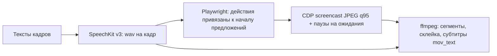
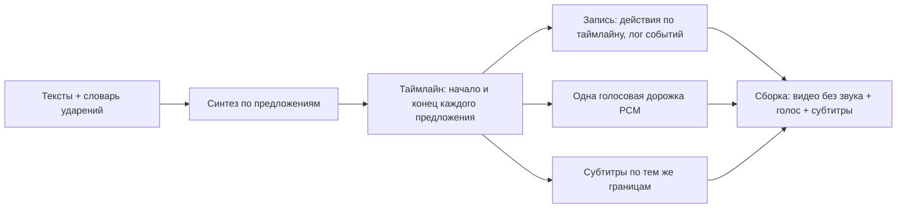

# Демо-видео веб-сервиса: запись браузера + синтез голоса + сборка

Разбор пайплайна, которым собирали демо repo-vitals (Playwright + Yandex SpeechKit + ffmpeg), и что в нём
было сделано коряво. Цель — в следующий раз собирать сразу правильно, а не чинить по ревью.

## Как было устроено

- Длительность кадра задаёт голос. Действия в браузере ставятся на метки начала предложений.
- Ожидания (загрузка, логин, анализ) вырезаются паузами захвата, в видео их нет.
- `recordVideo` Playwright даёт мутную картинку — нужен CDP `Page.startScreencast`.

## Что было коряво и как правильно

| Проблема                                    | Почему случилось                                                  | Как правильно                                                                                                    |
| ------------------------------------------- | ----------------------------------------------------------------- | ---------------------------------------------------------------------------------------------------------------- |
| Провалы на стыках кадров (~1,2 с тишины)    | у каждого wav своя тишина в начале и конце + поля сборки по 0,3 с | обрезать тишину каждого куска синтеза, задавать паузы явно (между предложениями ~0,3 с, между кадрами ~0,5 с)    |
| Щелчки и предупреждения AAC на стыках       | звук кодировался в каждом сегменте, потом склейка                 | видео склеивать без звука, голос собрать одной PCM-дорожкой, кодировать в AAC один раз                           |
| Субтитры раньше голоса на 0,4–0,65 с        | время реплик считалось пропорционально числу символов             | брать реальные границы: синтез идёт по предложениям, длина каждого куска известна точно                          |
| Неверные ударения («вЕса» вместо «весА»)    | синтез не знает контекста                                         | словарь ударений `+` перед ударной гласной только в тексте для синтеза; прослушать спорные кадры до записи видео |
| Действия длиннее голоса                     | сценарий кадра писался без бюджета времени                        | до записи посчитать окна между предложениями; `DRY=1`-прогон без побочных эффектов                               |
| Неповторяемые действия потрачены на отладку | живой анализ на проде запускался во время проб                    | побочные эффекты (анализ, пересчёт) — только в чистовой записи; отладка — сухим прогоном                         |
| Вклейка-зум выглядела как ошибка монтажа    | крупный план сделан зумом всей страницы                           | выделять элемент (обводка/увеличение блока), а не масштабировать страницу                                        |
| Время анализа не попало в кадр              | точное время было только в `title`-подсказке                      | проверять, что нужный текст реально виден на экране, а не в атрибуте                                             |
| Прокрутка не работала на SPA                | скроллится внутренний контейнер, а не окно                        | искать прокручиваемый контейнер, а не `window.scrollTo`                                                          |
| Ломались регулярки в правках кода           | heredoc в shell съедал обратные слэши                             | правки кода — через файловые инструменты, не через heredoc/sed                                                   |

## Правильная архитектура: таймлайн — источник правды

Главная ошибка — три независимых расчёта времени (видео, звук, субтитры), которые потом подгонялись друг
к другу. Правильно — один таймлайн, из которого генерируется всё остальное.

То же правило работает за пределами демо: если звук нужно привязать к движению (камера наезжает на
источник), синхронизация берётся из сцены или таймлайна событий, а не из готового видео. Для 3D-сцен —
источник звука на объекте в Blender/Godot, движок сам считает затухание, панораму и Доплер от камеры.

## Чек-лист перед следующим демо

- [ ] Тексты сверены с живым интерфейсом, спорные ударения размечены, один кадр прослушан до остальных.
- [ ] Для каждого кадра посчитан бюджет действий по окнам предложений.
- [ ] Сухой прогон всех кадров без побочных эффектов на проде.
- [ ] Побочные эффекты (анализ, пересчёт, отправка форм) — один раз, в чистовой записи.
- [ ] Секреты (сессия браузера, ключи) не попадают в файлы проекта и удаляются после записи.
- [ ] Сборка: одна голосовая дорожка, проверка `ffmpeg -v warning` без предупреждений, нет пауз длиннее 1 с.
- [ ] Финальная проверка раскадровкой: нет белых экранов, курсор виден, нужный текст читается.
